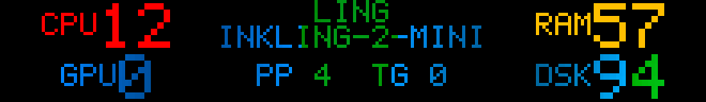

# hbtop

A Braille dot-matrix system scoreboard for the terminal. Large numeric
CPU/GPU/RAM/DSK readouts frame a switchable center panel for LLM inference /
leaderboards / processes, with a modern colour-DMD aesthetic.

Designed for shallow panes (herdr, tmux, ssh) where every row counts.



*CPU/GPU on the left, RAM/DSK on the right, LLM view in the centre.*

## Features

- **Braille dot matrix renderer** — every character is a 2×4 dot block
  (U+2800–U+28FF), with a 5×7 pixel font.
- **Large numeric readouts** — CPU, GPU, RAM and DSK with short labels and big
  values. CPU and RAM numbers are coloured by temperature.
- **Temperature gradient** — cyan → yellow → orange → red, driven by real
  sensors.
- **Center modules** — PP/TG leaderboards, LLM inference, process list.
- **Live llama.cpp metrics** — prompt / generation throughput, request state,
  model name, run detection.
- **Persistent leaderboards** — top 10 PP and TG, per model and per run.
- **Action takeovers** — model loading / ready, inference finished, new high
  score, offline.
- **Provider wordmarks** — LFM, QWEN, LING with palette sweeps; optional
  `.branim.json` animations.
- **Offline dashboard** — the CPU/GPU/RAM/DSK numbers stay visible while the
  centre cycles provider wordmarks when no model is loaded.

## Requirements

- Linux (the collectors read `/proc`, `/sys/class/hwmon` and optionally
  `rocm-smi`).
- Go 1.27+ to build.
- Optional: `rocm-smi` for AMD GPU stats.
- Optional: a llama.cpp server exposing `/health`, `/props`, `/slots`,
  `/metrics`.

## Build

```bash
make build
```

The Makefile uses `go` from `PATH`.

## Run

```bash
./hbtop
# or a specific config:
./hbtop configs/default.toml
```

The app looks for configuration in this order:

1. `$HBTOP_CONFIG`
2. `~/.config/hbtop/theme.toml`
3. `configs/default.toml`

## Keys

| Key | Action |
| --- | --- |
| `Tab` | Cycle center modules |
| `1` | PP leaderboard |
| `2` | TG leaderboard |
| `l` | Toggle PP/TG leaderboard |
| `i` | LLM inference view |
| `p` | Process view |
| `m` | Combined → model-only → run-only leaderboard |
| `q` / `Esc` | Quit |

## Display layout

- **Left:** CPU and GPU numbers.
- **Center:** switchable module (leaderboard, LLM, processes).
- **Right:** RAM and DSK numbers.

The stat rows keep readable numbers at short heights; CPU and RAM are
temperature-coloured.

## Center modules

- **TG leaderboard (default)** — top 10 text-generation scores.
- **PP leaderboard** — top 10 prompt-processing scores.
- **LLM view** — model name, last-run PP/TG, live PP/TG during inference,
  provider wordmark. If no live or run data exists yet, it falls back to the
  latest recorded leaderboard score for the model, then cumulative server
  averages from the Prometheus counters.
- **Process view** — PID, name, user, CPU%, MEM% in regular text.

## Documentation

- [Configuration reference](docs/CONFIG.md)
- [Architecture](docs/ARCHITECTURE.md)
- [Development](docs/DEVELOPMENT.md)
- [branim animation format](docs/BRANIM.md)
- [Contributing](CONTRIBUTING.md)

## Status

Prototype. The collectors target Linux; macOS/Windows are not implemented.
The `[theme]` and `[layout]` config sections are reserved for future use.

## License

MIT — see [LICENSE](LICENSE).
